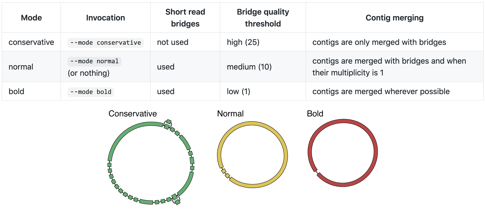
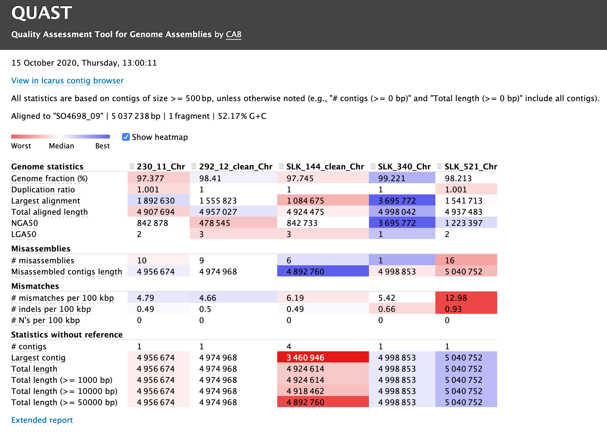

.. _ngs-assembly:

*************************
*De novo* genome assembly
*************************

Introduction
############

1. An assembly is the reconstruction of genomes through DNA sequencing. Since it is impossible to sequence all genome base-by-base, we need to reconstruct it indirectly [MILLER2010]_.

2. For that we use *de novo* assembly tools that overlap sequence **reads** into larger contiguous sequences, or **contigs**. With short reads only, the assembly is usually fragmented in many contigs (**draft** genome). With long reads, it is possible to obtain **complete** genomes, where the chromosome and each plasmid are a single circular sequence.

3. The most broadly accepted data file format for an assembly is ``FASTA``.

4. In this section, you will follow this approach:

   * **Short-read assembly** of the Illumina reads with |shovill|.
   * **Long-read assembly** of the Nanopore reads with |autocycler|, followed by **reorientation** of the circular replicons with |dnaapler| and **polishing** with the Illumina reads (|polypolish|). This is the final (hybrid) assembly.
   * **Hybrid assembly** with |unicycler|, to confirm that no **small plasmids** are missing from the final assembly.
   * **Quality control** of all the assemblies with |quast| and |checkm2|.

Learning objectives
###################

After finishing this Tutorial section, you will be able to:

* Perform a *de novo* assembly of short reads (Illumina) and long reads (Nanopore).
* Polish a long-read assembly with short reads and reorient its replicons.
* Recognise the chromosome and the plasmids of a complete genome.
* Evaluate the quality, completeness and contamination of a genome assembly.

Short-read assembly
###################

Shovill
*******

* |shovill| is a pipeline that assembles bacterial isolate genomes from Illumina paired-end reads. It uses |spades| as assembler [BANKEVICH2012]_, and adds some steps before and after the assembly that make it faster and improve the final result:

  1. Estimates the genome size and **subsamples** the reads to a maximum depth (default: 150x).
  2. Corrects sequencing errors of the reads.
  3. Assembles the reads with |spades|.
  4. **Corrects** the errors of the final contigs (by mapping the reads back to the assembly) and removes very short or low coverage contigs.

* |shovill| with |spades| gives good results in terms of recovered genome features and errors, both for reads of 150 and 300 bp.

Installation
............

.. code-block:: bash

   # Deactivate all the current environments
   $ conda deactivate

   # Create a new environment named shovill and install Shovill (SPAdes is installed together)
   $ mamba create -n shovill shovill

   # Activate the new environment
   $ conda activate shovill

   # Check the installation
   $ shovill --version
   $ shovill --check

Usage
.....

**1. Input/Output files**

``Input``: The clean paired-end Illumina reads (``.fastq.gz``), see :ref:`quality control <ngs-qc>`.

``Output``: Several files are produced by |shovill|. The most important are ``contigs.fa`` (final contigs in FASTA format), ``contigs.gfa`` (assembly graph in `GFA v1 <https://github.com/GFA-spec/GFA-spec/blob/master/GFA1.md>`_ format) and ``shovill.log`` (log file).

**2. Basic commands**

.. code-block:: bash

   # Let's first create new directories to store your assemblies
   $ mkdir -p ~/tutorial/assembly/shovill
   $ cd ~/tutorial/assembly/shovill

   # Run Shovill with SPAdes in the clean paired-end Illumina reads
   $ shovill --R1 ~/tutorial/qc_improvement/strainA_clean_R1.fastq.gz \
             --R2 ~/tutorial/qc_improvement/strainA_clean_R2.fastq.gz \
             --kmers 21,33,55,77,99,101,111,121,127 \
             --opts "--cov-cutoff auto" \
             --assembler spades \
             --outdir strainA \
             --namefmt "strainA_%05d" \
             --cpus 4 \
             --force

   # Copy the final contigs to a new file with a meaningful name
   $ cp strainA/contigs.fa strainA_shovill.fasta

.. csv-table:: Parameters explanation when using Shovill
   :header: "Parameter", "Description"
   :widths: 20, 60

   "``--R1`` / ``--R2``", "Forward and reverse reads"
   "``--kmers LIST``", "List of k-mer sizes used by SPAdes (default: automatic)"
   "``--opts STR``", "Extra options passed to the assembler (here, ``--cov-cutoff auto`` to remove low coverage contigs in SPAdes)"
   "``--assembler NAME``", "Assembler to use: spades (default), skesa, velvet or megahit"
   "``--outdir DIR``", "Output directory"
   "``--namefmt STR``", "Format of the contig names (e.g., ``strainA_00001``)"
   "``--cpus NUM``", "Number of CPUs to use"
   "``--ram NUM``", "Maximum memory to use, in GB"
   "``--depth NUM``", "Subsample the reads to this depth; 0 to disable (default: 150)"
   "``--force``", "Overwrite the output directory if it already exists"

.. note::
   The k-mer list starts in **21**, so that short k-mers are also used. This can help to assemble some **low copy AMR genes** that are missed with the default k-mers.

**3. Additional options**

.. code-block:: bash

   # To see a full list of available options in Shovill
   $ shovill --help

**4. Running Shovill in several samples**

Use a loop to assemble all the samples with the same parameters. Run one sample at a time with all the CPUs, instead of several samples at the same time, unless you have a lot of memory.

.. code-block:: bash

   $ cd ~/tutorial/assembly/shovill
   while read -r sample; do
      echo "Assembling ${sample}"
      shovill --R1 ~/tutorial/qc_improvement/${sample}_clean_R1.fastq.gz \
              --R2 ~/tutorial/qc_improvement/${sample}_clean_R2.fastq.gz \
              --kmers 21,33,55,77,99,101,111,121,127 \
              --opts "--cov-cutoff auto" \
              --assembler spades \
              --outdir ${sample} \
              --namefmt "${sample}_%05d" \
              --cpus 4 \
              --force > ${sample}_shovill.stdout 2>&1
      cp ${sample}/contigs.fa ${sample}_shovill.fasta
   done < ~/tutorial/samples.txt

   # Count the number of contigs in each assembly
   $ grep -c '>' *_shovill.fasta

.. todo::
   1. Run |shovill| in the clean paired-end Illumina reads of all the samples.
   2. How many contigs does each assembly have? Why is a short-read assembly fragmented?

Long-read assembly
##################

Autocycler
**********

* |autocycler| builds a **consensus** long-read assembly of a bacterial genome. Instead of trusting a single assembler, it:

  1. Estimates the genome size and divides the reads in 4 **subsamples**.
  2. Assembles each subsample with **different assemblers** (Raven, Myloasm, miniasm, Flye, metaMDBG, NECAT, NextDenovo, Plassembler and Canu).
  3. **Compresses** all the assemblies into a graph and **clusters** the contigs that belong to the same replicon (chromosome or plasmid).
  4. **Trims** the overlaps of the circular contigs and **resolves** a consensus sequence for each replicon.
  5. **Combines** all the replicons in the final assembly.

* Errors that appear in only one of the assemblies are not included in the consensus, so the final assembly is usually more accurate than the one of any single assembler.

* In this Tutorial, |autocycler| is run **automatically** with the script ``autocycler_full.sh`` provided by its developer (Ryan Wick), that runs all the steps above.

* The input are the Nanopore reads after |chopper|, |porechop| and |filtlong| (``_filtered``).

Installation
............

The developer of |autocycler| provides a conda environment file with |autocycler| and all the assemblers used by the script.

.. code-block:: bash

   # Deactivate all the current environments
   $ conda deactivate

   # Download the conda environment file and the automated script
   $ mkdir -p ~/software/autocycler
   $ cd ~/software/autocycler
   $ wget https://raw.githubusercontent.com/rrwick/Autocycler/main/pipelines/Conda_environment_file_by_Ryan_Wick/environment.yml
   $ wget https://raw.githubusercontent.com/rrwick/Autocycler/main/pipelines/Automated_Autocycler_Bash_script_by_Ryan_Wick/autocycler_full.sh
   $ chmod +x autocycler_full.sh

   # Create the autocycler environment from the file (it takes a while: it installs all the assemblers)
   $ conda env create --file environment.yml --name autocycler

   # Activate the new environment
   $ conda activate autocycler

   # Download the database of Plassembler (one of the assemblers) into the environment directory
   $ plassembler download -d "$CONDA_PREFIX"/plassembler_db

   # Check the installation
   $ autocycler --version

.. note::
   If some packages are not available for your platform (e.g., macOS) or conflict with each other, the developer suggests commenting out (``#``) the corresponding lines of ``environment.yml``. The script needs all the assemblers, so check the `Autocycler wiki <https://github.com/rrwick/Autocycler/wiki>`_ in that case.

Usage
.....

**1. Input/Output files**

``Input``: The filtered Nanopore reads (``_filtered.fastq.gz``).

``Output``: The final consensus assembly in ``autocycler_out/consensus_assembly.fasta`` (and ``.gfa``). The script also keeps the directories ``subsampled_reads`` and ``assemblies`` (the assemblies of each assembler and their logs), and the file ``autocycler.stderr`` with the messages of all the steps.

**2. Basic commands**

.. warning::

   * The long-read assembly with |autocycler| is the slowest step of this Tutorial: it runs 9 assemblers in 4 subsamples (36 assemblies). It can take several hours for each genome.

   * If you are unable to run |autocycler| please download the final assemblies using this `link <https://mega.nz/folder/du5DnCgL#UTgfvuksgI66oiRz3ZO2NA>`_.

.. code-block:: bash

   # The script writes all the files in the current directory, so create one directory per sample
   $ mkdir -p ~/tutorial/assembly/autocycler/strainA
   $ cd ~/tutorial/assembly/autocycler/strainA

   # Run Autocycler: reads, threads per assembly, number of assemblies running at the same time, and read type
   $ ~/software/autocycler/autocycler_full.sh ~/tutorial/qc_improvement/strainA_nanopore_filtered.fastq.gz 4 2 ont_r10

   # See the replicons of the consensus assembly
   $ grep '>' autocycler_out/consensus_assembly.fasta

.. csv-table:: Arguments of autocycler_full.sh
   :header: "Argument", "Description"
   :widths: 20, 60

   "1. reads", "Input reads in fastq format (can be gzipped)"
   "2. threads", "Number of threads of each assembly"
   "3. jobs", "Number of assemblies running at the same time (threads x jobs should not be higher than the CPUs of your computer)"
   "4. read type (optional)", "``ont_r10`` (default), ``ont_r9``, ``pacbio_clr`` or ``pacbio_hifi``"

.. hint::
   Use ``ont_r9`` for older Nanopore data (R9.4.1 flow cells). Recent data, such as the R10.4.1 flow cells (e.g., FLO-MIN114), use the default ``ont_r10``.

.. note::
   Check the clusters in ``autocycler_out/clustering``. A replicon found in only a few of the assemblies (e.g., a small plasmid) may fail the cluster QC and be excluded. This is why we also run |unicycler| below.

**3. Running Autocycler in several samples**

.. code-block:: bash

   $ cd ~/tutorial
   while read -r sample; do
      echo "Assembling ${sample}"
      mkdir -p assembly/autocycler/${sample}
      cd assembly/autocycler/${sample}
      ~/software/autocycler/autocycler_full.sh ~/tutorial/qc_improvement/${sample}_nanopore_filtered.fastq.gz 4 2 > autocycler.stdout 2>&1
      cd ~/tutorial
   done < samples.txt

**4. Additional options**

.. code-block:: bash

   # To see a full list of the Autocycler commands and options
   $ autocycler --help

.. seealso::
   The `Autocycler wiki <https://github.com/rrwick/Autocycler/wiki>`_ explains each step of the script (``subsample``, ``helper``, ``compress``, ``cluster``, ``trim``, ``resolve`` and ``combine``), in case you want to run them manually or inspect the intermediate results.

.. todo::
   3. Run |autocycler| in the filtered Nanopore reads of strainA and strainB.
   4. How many clusters (replicons) did you obtain? Which one is the chromosome? Are they circular?

Reorientation
#############

Dnaapler
********

* Circular sequences have no real start, so each assembler starts the chromosome and the plasmids at a random position.

* |dnaapler| **reorients** the circular replicons so that they start at a standard gene: *dnaA* for the chromosome and the replication gene (*repA*) for the plasmids [BOURAS2024B]_. This makes the comparison between genomes easier.

* |dnaapler| is run directly on the |autocycler| assembly graph (``consensus_assembly.gfa``), **before** the polishing. With a GFA file, it uses the graph to know which sequences are **circular**, and it only reorients those. With a FASTA file, a linear sequence could be wrongly reoriented as if it were circular.

* The output is also a GFA file, that is converted to FASTA with ``autocycler gfa2fasta``.

Installation
............

Install |dnaapler| in the ``autocycler`` environment, since you also need |autocycler| for the conversion to FASTA.

.. code-block:: bash

   # Activate the autocycler environment and install Dnaapler
   $ conda activate autocycler
   $ mamba install dnaapler

   # Check the installation
   $ dnaapler --version

Usage
.....

.. code-block:: bash

   $ cd ~/tutorial/assembly/autocycler/strainA

   # Reorient the circular sequences of the Autocycler assembly graph
   $ dnaapler all -i autocycler_out/consensus_assembly.gfa -o dnaapler -t 4

   # Convert the reoriented graph to FASTA
   $ autocycler gfa2fasta -i dnaapler/dnaapler_reoriented.gfa -o strainA_reoriented.fasta

.. csv-table:: Parameters explanation when using Dnaapler
   :header: "Parameter", "Description"
   :widths: 20, 60

   "``all``", "Reorients all the replicons (chromosome, plasmids and phages)"
   "``chromosome``", "Reorients only the chromosome (starting at *dnaA*)"
   "``-i FILE``", "Input assembly, in GFA (recommended) or FASTA format"
   "``-o DIR``", "Output directory"
   "``-p STR``", "Prefix of the output files (default: ``dnaapler``)"
   "``-t NUM``", "Number of threads"
   "``-f``", "Overwrite the output directory if it already exists"

.. attention::
   After the reorientation, the **replication gene** (*rep*) of a plasmid can be split between the end and the start of the sequence. Since the sequence is circular this is not a problem for the plasmid, but tools such as |plasmidfinder| may not detect it. For that reason, in this Tutorial |plasmidfinder| is also run on the Illumina-only assembly (|shovill|). See the :ref:`Plasmids <ngs-plasmids>` section.

Polishing
#########

* Long-read assemblies have a few **small errors** (mostly single-base substitutions and small insertions and deletions in homopolymers), that can create false frameshifts in the genes.

* These errors are corrected (**polishing**) using the more accurate Illumina reads.

* The reoriented assembly is always polished with |polypolish|. It is a very safe polisher: it is unlikely to introduce errors, so it is always used first.

Installation
************

.. code-block:: bash

   # Deactivate all the current environments
   $ conda deactivate

   # Create a new environment named polish with Polypolish and BWA (to align the reads)
   $ mamba create -n polish polypolish bwa

   # Activate the new environment
   $ conda activate polish

   # Check the installation
   $ polypolish --version

Polypolish
**********

|polypolish| aligns the Illumina reads to **all** the possible positions of the assembly (also in repeats), and corrects the errors where the reads clearly support a different base [WICK2022]_.

.. code-block:: bash

   # Create a new directory for the polished assemblies
   $ mkdir -p ~/tutorial/assembly/polish/strainA
   $ cd ~/tutorial/assembly/polish/strainA

   # Copy the reoriented assembly
   $ cp ~/tutorial/assembly/autocycler/strainA/strainA_reoriented.fasta .

   # 1. Align the clean Illumina reads to the assembly (each read file separately, with -a to keep all the alignments of each read)
   $ bwa index strainA_reoriented.fasta
   $ bwa mem -t 4 -a strainA_reoriented.fasta ~/tutorial/qc_improvement/strainA_clean_R1.fastq.gz > alignments_1.sam
   $ bwa mem -t 4 -a strainA_reoriented.fasta ~/tutorial/qc_improvement/strainA_clean_R2.fastq.gz > alignments_2.sam

   # 2. Filter the alignments with an incongruous insert size (it helps a little with the errors in repeats)
   $ polypolish filter --in1 alignments_1.sam --in2 alignments_2.sam --out1 filtered_1.sam --out2 filtered_2.sam

   # 3. Polish the assembly
   $ polypolish polish strainA_reoriented.fasta filtered_1.sam filtered_2.sam > strainA_polypolish.fasta

   # Remove the index and the alignment files (they are very large)
   $ rm *.bwt *.pac *.ann *.amb *.sa *.sam

   # Copy the final assembly to a new directory
   $ mkdir -p ~/tutorial/assembly/final
   $ cp strainA_polypolish.fasta ~/tutorial/assembly/final/strainA.fasta

.. csv-table:: Parameters explanation when using Polypolish
   :header: "Parameter", "Description"
   :widths: 20, 60

   "``filter --in1/--in2``", "Alignments of the forward and reverse reads (SAM format)"
   "``filter --out1/--out2``", "Filtered alignments"
   "``polish ASSEMBLY SAM1 SAM2``", "Assembly to polish and the filtered alignments"
   "``--careful``", "(polish) Ignore the alignments with too many mismatches; recommended when the Illumina depth is low"

.. note::
   The number of changes made by |polypolish| is printed at the end of its output. The changes are expected to be **few**, small (mostly single bases) and spread across the genome. Many changes, large changes, or changes concentrated in one region are a red flag that something odd is happening in that part of the genome.

.. hint::
   The best polishing strategy depends on the **depth of the Illumina reads** (you calculated the coverage in the :ref:`quality control <ngs-qc>` section). Most of the errors are corrected with a depth of about **25x** or more:

   * **Above 25x**: |polypolish| with the default parameters. This is the case of the Tutorial data.
   * **Between 5x and 25x**: |polypolish| with ``--careful``, followed by |pypolca| with ``--careful``.
   * **Below 5x**: |polypolish| with ``--careful`` only.

.. note::
   |polypolish| is the only **mandatory** polishing step. Optionally, a second polishing step can be done with |pypolca| [BOURAS2024A]_, which may correct some errors that |polypolish| missed (e.g., in regions with low coverage of Illumina reads). Install it with ``mamba install -n polish pypolca`` and run it on the |polypolish| assembly (e.g., ``pypolca run -a strainA_polypolish.fasta -1 strainA_clean_R1.fastq.gz -2 strainA_clean_R2.fastq.gz -t 4 -o pypolca --careful``). Do not assume that its changes are always improvements: check each changed region.

.. seealso::
   To see exactly which changes were made by a polisher, you can compare the assemblies before and after polishing with the script ``compare_assemblies.py`` of the `Perfect bacterial genome tutorial <https://github.com/rrwick/Perfect-bacterial-genome-tutorial>`_ by Ryan Wick.

**Running the reorientation and polishing in several samples**

.. code-block:: bash

   $ cd ~/tutorial
   $ mkdir -p assembly/final
   while read -r sample; do
      echo "Reorienting and polishing ${sample}"
      # Reorientation (autocycler environment)
      conda activate autocycler
      cd ~/tutorial/assembly/autocycler/${sample}
      dnaapler all -i autocycler_out/consensus_assembly.gfa -o dnaapler -t 4 -f
      autocycler gfa2fasta -i dnaapler/dnaapler_reoriented.gfa -o ${sample}_reoriented.fasta
      # Polishing (polish environment)
      conda activate polish
      mkdir -p ~/tutorial/assembly/polish/${sample}
      cd ~/tutorial/assembly/polish/${sample}
      cp ~/tutorial/assembly/autocycler/${sample}/${sample}_reoriented.fasta .
      bwa index ${sample}_reoriented.fasta
      bwa mem -t 4 -a ${sample}_reoriented.fasta ~/tutorial/qc_improvement/${sample}_clean_R1.fastq.gz > alignments_1.sam
      bwa mem -t 4 -a ${sample}_reoriented.fasta ~/tutorial/qc_improvement/${sample}_clean_R2.fastq.gz > alignments_2.sam
      polypolish filter --in1 alignments_1.sam --in2 alignments_2.sam --out1 filtered_1.sam --out2 filtered_2.sam
      polypolish polish ${sample}_reoriented.fasta filtered_1.sam filtered_2.sam > ${sample}_polypolish.fasta
      rm *.bwt *.pac *.ann *.amb *.sa *.sam
      cp ${sample}_polypolish.fasta ~/tutorial/assembly/final/${sample}.fasta
      cd ~/tutorial
   done < samples.txt

.. todo::
   5. Reorient the |autocycler| assemblies of strainA and strainB with |dnaapler|. Which sequences were reoriented, and which gene was used for each of them? (see the ``dnaapler`` output directory)
   6. Polish the reoriented assemblies with |polypolish|. How many changes were made in each assembly? Based on the Illumina coverage, which polishing strategy should you use?
   7. Look at the first gene of the chromosome in the next section (annotation): is it *dnaA*?

Hybrid assembly
###############

Unicycler
*********

* |unicycler| performs a **hybrid assembly** of bacterial genomes: it assembles the Illumina reads (with |spades|) and uses the long reads to connect the contigs [WICK2017]_.

* In this Tutorial, |unicycler| is used to confirm that no **small plasmids** are missing from the final assembly. Small plasmids are often lost in long-read assemblies, because they have few long reads, but they are usually well covered by the Illumina reads.

* For that reason, the Nanopore reads used here are only cleaned with |chopper| and |porechop| (``_nodcs_noadapt``), **without** the |filtlong| step that removes the shortest reads.

Installation
............

.. code-block:: bash

   # Deactivate all the current environments
   $ conda deactivate

   # Create a new environment named unicycler and install Unicycler (and SPAdes)
   $ mamba create -n unicycler unicycler

   # Activate the new environment and check the installation
   $ conda activate unicycler
   $ unicycler --version

Usage
.....

**1. Input/Output files**

``Input``: The clean Illumina reads and the Nanopore reads ``_nodcs_noadapt`` (without size filtering).

``Output``: Several files are produced by |unicycler|. However, particular attention will be given to ``assembly.fasta`` (final assembly in FASTA format), ``assembly.gfa`` (final assembly graph) and ``unicycler.log`` (Unicycler log file).

**2. Basic commands**

.. warning::
   You will need at least 12 Gb of RAM to be able to run |unicycler|.

.. code-block:: bash

   # Let's first move to the directory where you want to store your assemblies
   $ mkdir -p ~/tutorial/assembly/unicycler
   $ cd ~/tutorial/assembly/unicycler

   # Run Unicycler using the clean Illumina reads and the Nanopore reads without size filtering
   $ unicycler -1 ~/tutorial/qc_improvement/strainA_clean_R1.fastq.gz -2 ~/tutorial/qc_improvement/strainA_clean_R2.fastq.gz -l ~/tutorial/qc_improvement/strainA_nanopore_nodcs_noadapt.fastq.gz --mode normal -o strainA -t 4

   # Copy the final assembly to a new file with a meaningful name
   $ cp strainA/assembly.fasta strainA_unicycler.fasta

.. csv-table:: Parameters explanation when using Unicycler
   :header: "Parameter", "Description"
   :widths: 20, 60

   "``-1 SHORT1``", "FASTQ file of first short reads in each pair (required)"
   "``-2 SHORT2``", "FASTQ file of second short reads in each pair (required)"
   "``-l LONG``", "FASTQ or FASTA file of long reads (optional)"
   "``--mode {conservative,normal,bold}``", "Bridging mode (default: normal)"
   "``-o OUT``", "Output directory (required)"
   "``-t THREADS``", "Number of threads used (default: 8)"
   "``--min_fasta_length LENGTH``", "Exclude contigs shorter than this length from the final assembly (default: 100)"

*Figure 15. Specific differences between the three allowed modes. Retrieved from Unicycler official GitHub page.*

**3. Understanding the Unicycler assembly**

The sequence headers of the ``assembly.fasta`` file produced by |unicycler| contain useful information:

.. code-block:: bash

   $ grep '>' strainA_unicycler.fasta
   >1 length=5445618 depth=1.00x circular=true
   >2 length=92721 depth=1.13x circular=true
   >3 length=3365 depth=2.31x circular=true

* ``length``: length of the sequence in bp.
* ``depth``: read depth relative to the median of the chromosome (``1.00x`` is the chromosome; ``2.31x`` means that the sequence has twice the copies of the chromosome, which is common in **small plasmids**).
* ``circular=true``: Unicycler found that the sequence is circular, i.e., it is a **complete** replicon (the chromosome or a complete plasmid).

**4. Comparing with the final assembly**

Compare the lengths of the sequences of the |unicycler| assembly and of the final assembly. A circular sequence of a few kb that is present in the |unicycler| assembly but not in the final assembly is probably a **small plasmid** that was missed.

.. code-block:: bash

   # Lengths of the sequences of both assemblies
   $ awk '/^>/{if(id) print id"\t"len; id=$1; len=0; next} {len+=length($0)} END{print id"\t"len}' strainA_unicycler.fasta
   $ awk '/^>/{if(id) print id"\t"len; id=$1; len=0; next} {len+=length($0)} END{print id"\t"len}' ~/tutorial/assembly/final/strainA.fasta

.. note::
   If a small plasmid is missing, it can be added to the final assembly (e.g., copying its sequence from the |unicycler| assembly).

**5. Running Unicycler in several samples**

.. code-block:: bash

   $ cd ~/tutorial/assembly/unicycler
   while read -r sample; do
      echo "Assembling ${sample}"
      unicycler -t 4 --mode normal \
         -1 ~/tutorial/qc_improvement/${sample}_clean_R1.fastq.gz -2 ~/tutorial/qc_improvement/${sample}_clean_R2.fastq.gz \
         -l ~/tutorial/qc_improvement/${sample}_nanopore_nodcs_noadapt.fastq.gz \
         -o ${sample} > ${sample}_unicycler.stdout 2>&1
      cp ${sample}/assembly.fasta ${sample}_unicycler.fasta
   done < ~/tutorial/samples.txt

   # Give a look at the sequences of all the assemblies
   $ grep '>' *_unicycler.fasta

.. note::
   Hybrid assemblies are slow (from 30 minutes to a few hours for each genome). If you are working on a server, run the loop in the background using ``nohup`` (see :ref:`Before we begin <before-begin>`) and check the ``*.stdout`` files.

.. todo::
   8. Run |unicycler| in strainA and strainB.
   9. Compare the |unicycler| assemblies with the final assemblies. Is any small plasmid missing in the final assemblies?

Assembly quality control
########################

* Quality control metrics of a genome assembly evaluate the contiguity, completeness, contamination, and correctness (i.e., proportion of the genome that is free from mistakes) of an assembly.

* In this section you will use |quast| to assess the contiguity and size of your genome assemblies, and |checkm2| to assess their completeness and contamination.

QUAST
*****

* |quast|  - **QUality ASsessment Tool** - is a tool that evaluates and compare genome assemblies by computing various metrics [GUREVICH2013]_.

* This tool can be used in single or multiple assemblies from different platforms to compare them and decide what is the best one for your further analysis.

Installation
............

.. code-block:: bash

   # Deactivate all the current environments
   $ conda deactivate

   # Activate the qc environment
   $ conda activate qc

   # Install QUAST
   $ mamba install quast

   # Check QUAST installation
   $ quast.py --version

Usage
.....

**1. Input/Output files**

``Input``: Accept assemblies and references in ``.fasta`` format. Genes and operons annotations must be in ``.gff`` or ``.txt`` format. For this part of the Tutorial, we will use the |shovill|, |unicycler| and final assemblies.

``Output``: QUAST computes various metrics. The most relevant for this Tutorial is the interactive ``.html`` report that contains a summary of the metrics presented in colourful tables and plots.

**2. Basic commands**

.. code-block:: bash

   # Let's first create new directories to store your reports
   $ cd ~/tutorial/assembly/
   $ mkdir quast
   $ cd quast/

   # Run QUAST in your assembly FASTA files (the *.fasta wildcard only selects the final assemblies that you copied)
   $ quast.py -t 4 -o report_without_reference ~/tutorial/assembly/shovill/*.fasta ~/tutorial/assembly/unicycler/*.fasta ~/tutorial/assembly/final/*.fasta

   # Run QUAST in your assembly FASTA files but provide a reference genome (the complete Sakai genome, with chromosome and plasmids)
   $ quast.py -t 4 -r ~/tutorial/raw_data/GCF_000008865.2_ASM886v2_genomic.fasta -o report_with_reference ~/tutorial/assembly/shovill/*.fasta ~/tutorial/assembly/unicycler/*.fasta ~/tutorial/assembly/final/*.fasta

   # Open QUAST html report in Ubuntu/WSL
   $ sensible-browser report_with_reference/report.html

   # Or open QUAST html report in macOS
   $ open report_with_reference/report.html

   # Print the main metrics directly in the terminal
   $ column -t -s $'\t' report_with_reference/transposed_report.tsv | cut -c 1-120

.. csv-table:: Parameters explanation when using QUAST
   :header: "Parameter", "Description"
   :widths: 20, 60

   "``-o <output_dir>``", "Specify the output directory"
   "``-r <filename>``", "File with reference genome. Most metrics can't be evaluated without reference"
   "``-g <filename>``", "File with genes annotations for given species (GFF, BED, NCBI or TXT); it must correspond to the reference used with ``-r`` (e.g., ``NC_002695.2.gff`` with ``NC_002695.2.fasta``)"
   "``-t <int>``", "Number of threads"
   "``--labels <list>``", "Comma-separated names of the assemblies in the report (e.g., ``--labels strainA_shovill,strainA_final``)"
   "``--min-contig <int>``", "Lower threshold for contig length (default: 500)"
   "``<fasta_file(s)>``", "Full path for the assembly FASTA files"

*Figure 16. Example of a QUAST HTML quality report of hybrid assemblies.*

.. seealso::
   Some of the most important metrics that you should pay attention in |quast| **final report** include:

   1. ``# contigs``: is the total **number of contigs** in the assembly.

   2. ``Largest contig``: is the length of the **longest contig** in the assembly.

   3. ``Total length``: is the total number of **bases** in the assembly.

   4. ``GC (%)``: is the total number of **G and C nucleotides** in the assembly, divided by the total length of the assembly.

   5. ``L50``: is the minimal number of contigs that cover 50% of the assembly (contigs equal or longer than N50).

   6. ``N50``: is the length for which the collection of all **contigs** of that length or longer covers at least 50% of the assembly length.

   7. ``NG50``: is the length for which the collection of all **contigs** of that length or longer covers at least 50% of the reference genome.

   8. ``NA50 and NGA50``: is the length for which the collection of **aligned blocks** of that length or longer covers at least 50% of the reference genome.

**3. Additional options**

.. code-block:: bash

   # To see a full list of available options in QUAST
   $ quast.py --help

.. hint::
   |quast| does not need a loop to run in several assemblies: just list all the ``.fasta`` files in the same command, as in the previous examples. If you have the assemblies of **several samples** (e.g., ``final/strainA.fasta`` and ``final/strainB.fasta``), the report will have one column for each of them. To control the names that appear in the report use ``--labels``.

.. warning::
   If |quast| fails with the error ``No module named 'distutils'``, your environment has a Python version higher than 3.11. Create the environment with ``mamba create -n qc python=3.11`` and install again all the packages.

.. todo::
   10. Assess the quality of the |shovill|, |unicycler| and final assemblies using |quast|.
   11. How many contigs does each assembly have? What is the N50 of the assemblies? What does this mean?
   12. Compare the short-read (|shovill|) and the final assemblies. What are the main differences?

CheckM2
*******

* |checkm2| estimates the **completeness** and the **contamination** of a genome assembly, using machine learning models trained on the presence of conserved genes [CHKLOVSKI2023]_.

* **Completeness**: the percentage of the expected genome that is present in the assembly.

* **Contamination**: the percentage of extra (duplicated) genes, that usually come from another organism in the same sample.

* In this Tutorial, genomes with less than **90% completeness** or more than **5% contamination** are removed from further analysis.

Installation
............

.. code-block:: bash

   # Deactivate all the current environments
   $ conda deactivate

   # Create a new environment named checkm2 and install CheckM2
   $ mamba create -n checkm2 checkm2

   # Activate the new environment and check the installation
   $ conda activate checkm2
   $ checkm2 --version

   # Download the CheckM2 database (~3 GB)
   $ checkm2 database --download --path ~/databases/checkm2

Usage
.....

**1. Input/Output files**

``Input``: A directory with the assemblies in ``.fasta`` format.

``Output``: A ``quality_report.tsv`` file with one line per genome.

**2. Basic commands**

.. code-block:: bash

   $ mkdir -p ~/tutorial/assembly/checkm2
   $ cd ~/tutorial/assembly/checkm2

   # Run CheckM2 in all the final assemblies (-x is the extension of the files)
   $ checkm2 predict -i ~/tutorial/assembly/final -x fasta -o final -t 4 \
        --database_path ~/databases/checkm2/CheckM2_database/uniref100.KO.1.dmnd

   # See the results
   $ column -t -s $'\t' final/quality_report.tsv | cut -c 1-120

   # Keep only the genomes with >= 90% completeness and <= 5% contamination
   $ awk -F'\t' 'NR==1 || ($2>=90 && $3<=5)' final/quality_report.tsv

.. csv-table:: Parameters explanation when using CheckM2
   :header: "Parameter", "Description"
   :widths: 20, 60

   "``-i DIR``", "Input directory (or files) with the assemblies"
   "``-x STR``", "Extension of the assembly files (e.g., ``fasta``, ``fna``)"
   "``-o DIR``", "Output directory"
   "``-t NUM``", "Number of threads"
   "``--database_path FILE``", "Path to the CheckM2 database (``.dmnd`` file)"

.. note::
   Check the exact name of the database file with ``ls ~/databases/checkm2/CheckM2_database/``. CheckM2 analyses all the assemblies of the input directory, so you do not need a loop.

.. todo::
   13. Run |checkm2| in the final assemblies and in the |shovill| assemblies.
   14. What is the completeness and contamination of each genome? Do they pass the thresholds of 90% completeness and 5% contamination?

Folder structure
################

At the end of this section, you will have the following folder structure.

::

    tutorial
    ├── raw_data
    ├── genomes
    ├── qc_visualisation
    ├── qc_improvement
    │   ├── <sample>_clean_R1.fastq.gz
    │   ├── <sample>_clean_R2.fastq.gz
    │   ├── <sample>_nanopore_nodcs_noadapt.fastq.gz
    │   ├── <sample>_nanopore_filtered.fastq.gz
    ├── taxonomy
    ├── assembly
    │   ├── shovill
    │   │   ├── <sample>_shovill.fasta
    │   │   ├── <sample>/ (Shovill output directory)
    │   ├── autocycler
    │   │   ├── <sample>
    │   │   │   ├── autocycler_out/consensus_assembly.gfa
    │   │   │   ├── dnaapler/dnaapler_reoriented.gfa
    │   │   │   ├── <sample>_reoriented.fasta
    │   ├── polish
    │   │   ├── <sample>
    │   │   │   ├── <sample>_reoriented.fasta
    │   │   │   ├── <sample>_polypolish.fasta
    │   ├── final
    │   │   ├── <sample>.fasta
    │   ├── unicycler
    │   │   ├── <sample>_unicycler.fasta
    │   │   ├── <sample>/ (Unicycler output directory)
    │   ├── quast
    │   │   ├── report_without_reference
    │   │   ├── report_with_reference
    │   ├── checkm2
    │   │   ├── final/quality_report.tsv

References
##########

.. [BANKEVICH2012] Bankevich A, et al. 2012. SPAdes: A New Genome Assembly Algorithm and Its Applications to Single-Cell Sequencing. J Comput Biol. 19(5):455–477. `DOI: 10.1089/cmb.2012.0021 <https://dx.doi.org/10.1089/cmb.2012.0021>`_.
.. [BOURAS2024A] Bouras G, Judd LM, Edwards RA, Vreugde S, Stinear TP, Wick RR. 2024. How low can you go? Short-read polishing of Oxford Nanopore bacterial genome assemblies. Microb Genom. 10(6):001254. `DOI: 10.1099/mgen.0.001254 <https://dx.doi.org/10.1099/mgen.0.001254>`_.
.. [BOURAS2024B] Bouras G, Grigson SR, Papudeshi B, Mallawaarachchi V, Roach MJ. 2024. Dnaapler: a tool to reorient circular microbial genomes. J Open Source Softw. 9(93):5968. `DOI: 10.21105/joss.05968 <https://dx.doi.org/10.21105/joss.05968>`_.
.. [CHKLOVSKI2023] Chklovski A, Parks DH, Woodcroft BJ, Tyson GW. 2023. CheckM2: a rapid, scalable and accurate tool for assessing microbial genome quality using machine learning. Nat Methods. 20(8):1203–1212. `DOI: 10.1038/s41592-023-01940-w <https://dx.doi.org/10.1038/s41592-023-01940-w>`_.
.. [GUREVICH2013] Gurevich A, Saveliev V, Vyahhi N, Tesler G. 2013. QUAST: quality assessment tool for genome assemblies. Bioinformatics. 29(8):1072–1075. `DOI: 10.1093/bioinformatics/btt086 <https://dx.doi.org/10.1093/bioinformatics/btt086>`_.
.. [MILLER2010] Miller JR, Koren S, Sutton G. 2010. Assembly algorithms for next-generation sequencing data. Genomics. 95(6):315-27. `DOI: 10.1016/j.ygeno.2010.03.001 <https://dx.doi.org/10.1016/j.ygeno.2010.03.001>`_.
.. [WICK2017] Wick RR, Judd LM, Gorrie CL, Holt KE. 2017. Unicycler: Resolving bacterial genome assemblies from short and long sequencing reads. PLoS Comput Biol. 13(6):e1005595. `DOI: 10.1371/journal.pcbi.1005595 <https://dx.doi.org/10.1371/journal.pcbi.1005595>`_.
.. [WICK2022] Wick RR, Holt KE. 2022. Polypolish: Short-read polishing of long-read bacterial genome assemblies. PLoS Comput Biol. 18(1):e1009802. `DOI: 10.1371/journal.pcbi.1009802 <https://dx.doi.org/10.1371/journal.pcbi.1009802>`_.

List of Assembly tools
######################

.. seealso::
   * The tools used in this Tutorial section are not the only ones available. Other tools can also be used to perform this task.

.. csv-table::
   Table with the tools used in this Tutorial section (installed by conda).
   :header: "Package name", "Version", "Main objective"
   :widths: 20, 20, 40

   "`Shovill <https://github.com/tseemann/shovill>`_", "1.1.0", "Short-read assembly (with SPAdes)"
   "`Autocycler <https://github.com/rrwick/Autocycler>`_", "0.6.2", "Long-read consensus assembly"
   "`Polypolish <https://github.com/rrwick/Polypolish>`_", "0.6.1", "Short-read polishing of long-read assemblies"
   "`Dnaapler <https://github.com/gbouras13/dnaapler>`_", "-", "Reorientation of circular replicons"
   "`Unicycler <https://github.com/rrwick/Unicycler>`_", "0.5.1", "Hybrid assembly (detection of small plasmids)"
   "`QUAST <https://github.com/ablab/quast>`_", "5.3.0", "Assembly quality control"
   "`CheckM2 <https://github.com/chklovski/CheckM2>`_", "1.0.2", "Assembly completeness and contamination"
