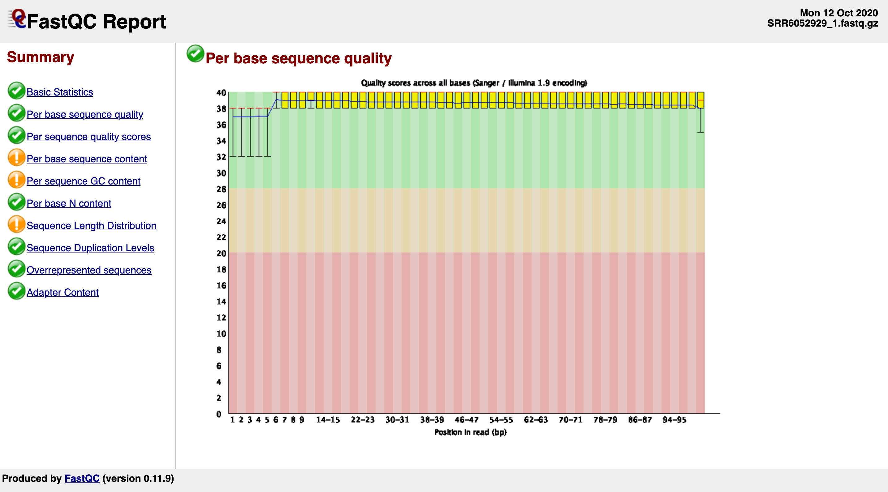
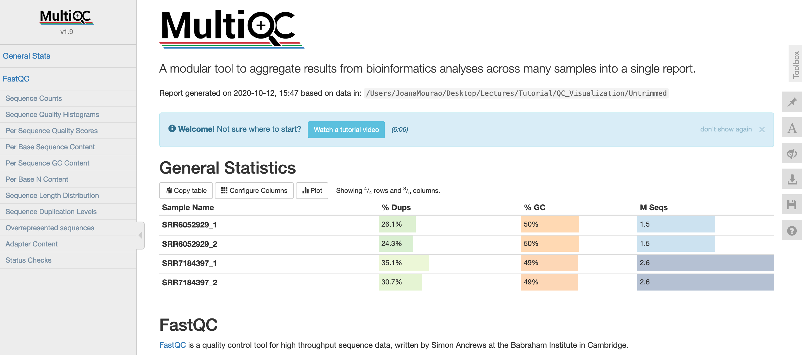

.. _ngs-qc:

***************
Quality control
***************

Introduction
############

1. We know that none of the described sequencing technologies is perfect; thus, they will generate different **types** and **amounts** of **errors**.

2. Therefore, it is of utmost importance to **identify** the errors that may influence further data analysis and interpretation.

3. In this section, you will first learn how to visualize the quality of the Illumina data using |fastqc| and |multiqc|.

4. After that, we will **trim** and **filter** the low quality or uninformative Illumina reads/bases through |fastp|.

5. Finally, you will evaluate (|nanoplot|), clean (|chopper|, |porechop|) and filter (|filtlong|) the Oxford Nanopore reads.

6. You will be working with the paired-end raw data acquired through the **Illumina HiSeq 2500** Platform and with the Oxford Nanopore reads of the same isolates [GREIG2019]_.

Learning objectives
###################

After finishing this Tutorial section, you will be able to:

* Calculate the sequencing coverage.
* Generate a full combined quality report.
* Assess and interpret the general quality of raw reads.
* Improve the quality of Illumina raw reads by trimming and filtering.
* Evaluate the quality of Oxford Nanopore reads and decide how to clean and filter them.
* Compare the quality of the reads before and after cleaning.

Coverage
########

1. As you already saw in the theoretical classes, a sequencing platform needs to sequence every base in a given sample several times.

2. The number of ``x`` times a genome has been sequenced (depth of sequencing) is expressed by a **coverage metric**.

3. There are no strict recommendations for ideal sequencing coverage. Most researchers determine the necessary coverage based on the type of study and available literature.

4. Ideal coverage for a genome assembly should be **50x or above** [ALBERT2019]_. It means that each base on average is sequenced 50 times.

.. hint::
   The coverage can be calculated using the following equations.

   **A. For an instrument with fixed read length:**

   ``C = LN / G``

   C: Coverage

   L: is the read length in bp (e.g., 150 bp)

   N: is the total number of sequenced reads (for paired-end data, count the reads of both files, R1 and R2)

   G: is the haploid genome length in bp

   **B. For an instrument with variable read length:**

   ``C = SUM(Li) / G``

   C: Coverage

   Li: is the length of read *i* in bp

   G: is the haploid genome length in bp

Let's try to do some basic analysis and calculate the coverage using the **paired-end Illumina raw reads** (files SRR6052929 and SRR7184397).

You can easily count the reads and the sequenced bases in the command line. Remember that each read has 4 lines in a fastq file.

.. code-block:: bash

   # Go to the raw_data directory
   $ cd ~/tutorial/raw_data

   # Display the first read (4 lines) of a compressed fastq file
   $ gunzip -c strainA_R1.fastq.gz | head -n 4

   # Count the number of reads of a sample
   $ gunzip -c strainA_R1.fastq.gz | awk 'END{print NR/4}'

   # Calculate the number of reads, bases and coverage (genome size = 5500000 bp)
   # of the forward and reverse reads together
   $ gunzip -c strainA_R1.fastq.gz strainA_R2.fastq.gz | awk -v G=5500000 'NR%4==2{n++; b+=length($0)} END{printf "reads=%d bases=%d coverage=%.1fx\n", n, b, b/G}'

Now, repeat the same calculation for **all the samples** using a loop and save the results in a table (the sample names are listed in the file ``samples.txt`` that you created in the data acquisition section):

.. code-block:: bash

   $ cd ~/tutorial
   $ echo -e "sample\treads\tbases\tcoverage" > coverage.tsv
   while read -r sample; do
      gunzip -c raw_data/${sample}_R1.fastq.gz raw_data/${sample}_R2.fastq.gz | awk -v s=$sample -v G=5500000 'NR%4==2{n++; b+=length($0)} END{printf "%s\t%d\t%d\t%.1f\n", s, n, b, b/G}' >> coverage.tsv
   done < samples.txt
   $ column -t coverage.tsv

.. todo::
   1. Open the file with the command line or with the text editor to get an idea about the structure.
   2. What is the unique identifier of each read in the fastq files? What is the read length?
   3. How many raw sequence reads are in the files?
   4. Calculate the coverage of strainA and strainB, assuming a genome size of ~5.5 Mb. Is it higher than 50x?
   5. Calculate the coverage of the Nanopore reads of both strains using the same equation and the second one (variable read length).

Visualisation of data quality
#############################

1. The first step after receiving the sequencing data is to perform some simple quality control evaluations.

2. This step will be important to ensure that your raw data looks good and there are no problems or biases.

2. For that, you’ll first use two programs called |fastqc| and |multiqc|, to visualize the quality of the raw reads.

FastQC
******

* We already saw in the :ref:`data acquisition <ngs-data>` section that to each base is assigned a |phred| quality score.

* In this section, we will see how to visualize all these scores collectively using |fastqc|.

* Also, |fastqc| will allow you to:

  1. Create user-friendly **plots** and **tables** to assess the general quality and composition of raw sequence data.
  2. Identify any **problems** originated either in the sequencer or in the starting library material.
  3. Export the results to an **HTML** based reports.

.. note::
   Don't forget that fastq errors are not entirely accurate measures, hence use them as **warnings** for further analysis.

Installation
............

.. code-block:: bash

    # Create a new environment named qc
    $ mamba create -n qc python=3.11

    # Activate the new environment
    $ conda activate qc

    # Install FastQC as a command-line utility
    $ mamba install fastqc

    # Check if FastQC is installed
    $ fastqc --version

Usage
.....

**1. Input/Output files**

``Input``: Accept compress or uncompress Illumina files such as ``.fastq`` or ``.fastq.gz``. For this part of the Tutorial, we will use the paired-end Illumina raw reads.

``Output``: Two files are produced, a ``.zip`` archive containing all the plots, and a ``.html`` report. You can open the HTML files with your web browser.

**2. Basic commands**

.. code-block:: bash

    # Let's first create three new directories to keep your reports
    $ cd ~/tutorial/
    $ mkdir qc_visualisation
    $ cd qc_visualisation/
    $ mkdir trimmed untrimmed
    $ cd

    # Run FastQC on multiple fastq.gz files at the same time
    # Specify the directory where your Illumina fastq.gz files are located
    # The wildcard *_R?.fastq.gz selects all the _R1 and _R2 files but not the Nanopore ones
    $ fastqc -t 4 ~/tutorial/raw_data/*_R?.fastq.gz -o ~/tutorial/qc_visualisation/untrimmed/

.. csv-table:: Parameters explanation when using FastQC
   :header: "Parameter", "Description"
   :widths: 20, 60

   "``-t NUM``", "Specifies the number of files which can be processed simultaneously (1 thread = 250 Mb memory)"
   "``-o NAME``", "Create all output files in the specified and already created output directory"
   "``--memory NUM``", "Sets the base amount of memory, in Megabytes, used to process each file (default: 512 Mb)"
   "``--nano``", "Files come from nanopore sequences and are in fast5 format"
   "``-q``", "Suppress all progress messages on stdout and only report errors"
   "``*_R?.fastq.gz``", "Full path to paired-end Illumina raw sequence reads (the ``?`` wildcard matches one character: 1 or 2)"

.. code-block:: bash

    # See the files that FastQC created
    $ cd ~/tutorial/qc_visualisation/untrimmed/
    $ ls

    # Open FastQC html report in Ubuntu/WSL
    $ sensible-browser <filename>_fastqc.html
    $ cd

    # Or open FastQC html report in macOS
    $ open <filename>_fastqc.html
    $ cd

**3. Additional options**

.. code-block:: bash

    # To see all the parameters available on FastQC
    $ fastqc --help

**4. Running FastQC in several samples**

FastQC accepts many files in the same command, so a loop is not mandatory. However, if you prefer to run each sample separately (e.g., to keep a log file per sample), you can use a loop:

.. code-block:: bash

   $ cd ~/tutorial
   $ mkdir -p logs
   while read -r sample; do
      fastqc -t 2 raw_data/${sample}_R1.fastq.gz raw_data/${sample}_R2.fastq.gz -o qc_visualisation/untrimmed/ &> logs/${sample}_fastqc.log
   done < samples.txt

.. hint::
   To run more than one sample **at the same time** you can use ``xargs``: ``cat samples.txt | xargs -P 2 -I {} sh -c 'fastqc -t 1 raw_data/{}_R1.fastq.gz raw_data/{}_R2.fastq.gz -o qc_visualisation/untrimmed/'``. Here ``-P 2`` means two samples in parallel. Do not use more processes than the CPUs of your computer.

.. todo::
   6. Run |fastqc| on all the downloaded paired-end Illumina raw reads and save a copy of the report in your computer.
   7. Explore the Fastqc `website <https://www.bioinformatics.babraham.ac.uk/projects/fastqc/Help/3%20Analysis%20Modules/>`_ and try to interpret your results according to the various quality modules.
      Pay special attention to the **Basic Statistics**, **Per base Sequence Quality** and **Sequence Length Distribution**.
   8. Do your sequences have any kind of adapters?
   9. Do you think these Illumina sequencing runs gave good quality sequences? Why?
   10. Based on the FastQC report, do you think your data will need further trimming and filtering? Why?

*Figure 9. Example of a FastQC report using paired-end Illumina raw reads on a macOS.*

MultiQC
*******

The |multiqc| tool is designed to combine different quality reports, such as the ones produced by |fastqc| into a single one, thus allowing multiple comparisons at the same time.

Installation
............

.. code-block:: bash

    # Deactivate all current environments
    $ conda deactivate

    # Create a new environment named multiqc
    $ mamba create -n multiqc

    # Activate the multiqc environment
    $ conda activate multiqc

    # Install MultiQC with conda
    $ mamba install multiqc

    # Check if MultiQC is installed
    $ multiqc --version

Usage
.....

**1. Input/Output files**

``Input``: In this tutorial you will use the ``fastqc.*`` quality visualisation reports.

``Output``: The MultiQC will generate an ``.html`` file containing the full report and a folder that contains easily machine readable data analysis.

**2. Basic commands**

.. code-block:: bash

    # Run MultiQC to combine the reports of all FastQC runs
    # Specify the directory where your FastQC reports are located (MultiQC searches it recursively)
    $ multiqc ~/tutorial/qc_visualisation/untrimmed/ -o ~/tutorial/qc_visualisation/untrimmed/

.. csv-table:: Parameters explanation when using MultiQC
   :header: "Parameter", "Description"
   :widths: 20, 60

   "``-o NAME``", "Create report in the specified and already created output directory"
   "``-q``", "Only show log warnings"
   "``<directory>``", "Full path to the directory with the FastQC quality visualisation reports"
   "``-n NAME``", "Name of the output report (e.g., ``-n multiqc_clean_report`` for the trimmed data)"
   "``-f``", "Overwrite existing reports"

.. code-block:: bash

    # Navigate to the directory containing the MultiQC .html report
    $ cd ~/tutorial/qc_visualisation/untrimmed/

    # Open MultiQC html report in Ubuntu/WSL
    $ sensible-browser multiqc_report.html
    $ cd

    # Or open MultiQC html report in macOS
    $ open multiqc_report.html
    $ cd

**3. Additional options**

.. code-block:: bash

   # To see all the parameters available on MultiQC
   $ multiqc --help

.. todo::
   11. Run |multiqc| on all the reports generated by FastQC.
   12. What are the paired-end Illumina raw reads that present the best quality? Why?

*Figure 10. Example of a MultiQC report using a combination of FastQC reports.*

Quality control
###############

1. In the previous section, we have **evaluated** and **visualised** the quality of our raw sequence reads using |fastqc|.

2. Now you have to decide if your data should be subject to **Quality Control (QC)**, i.e. the process of improving data by removing identifiable errors from it.

3. You must remember that by performing QC we can also introduce **errors** (we want the same data but with better quality). Thus, we should not perform QC if the quality appears to be satisfactory.

.. attention::
   Only perform QC if your data need it. Whether you should quality-trim, and what the threshold should be, depends on your **data quality** and their **intended use**. Often a threshold of **~10** is pretty good for most of the cases.

fastp
*****

If your data needs QC you can use |fastp| to remove adapters and filter low-quality reads. It is an all-in-one tool that performs the trimming and filtering and also writes its own ``.html`` and ``.json`` quality reports (before and after filtering).

Installation
............

.. code-block:: bash

    # Activate the qc environment
    $ conda activate qc

    # Install fastp
    $ mamba install fastp

    # Check if fastp is installed
    $ fastp --version

    # Let's also create a new directory to keep the clean raw sequence reads
    $ mkdir ~/tutorial/qc_improvement

Usage
.....

**1. Input/Output files**

``Input``: You will use the Illumina raw sequence data contained in the ``.fastq.gz`` files.

``Output``: fastp will generate the clean ``.fastq.gz`` files, an ``.html`` report and a ``.json`` report (that can be read by |multiqc|).

**2. Basic commands**

.. note::

   * When you have the **paired-end reads** in 2 files you should **always process them together**, not one at a time.

   * In the commands provided below don't forget to add the full path of your ``fastq.gz`` files.

   * In this Tutorial, |fastp| is run with the **standard parameters**: it automatically detects and removes the adapters, and it filters the reads with low quality, too many unknown bases or too short. Change the parameters only if your quality reports show that it is necessary.

.. code-block:: bash

    # Go to the directory where you want to keep the trimmed data
    $ cd ~/tutorial/qc_improvement/

    # Run fastp with the standard parameters
    $ fastp -i read1.fastq.gz -I read2.fastq.gz -o clean_R1.fastq.gz -O clean_R2.fastq.gz -h fastp_report.html -j fastp_report.json

.. csv-table:: Parameters explanation when using fastp
   :header: "Parameter", "Description"
   :widths: 20, 60

   "``-i`` / ``-I``", "Input forward (read1) and reverse (read2) reads"
   "``-o`` / ``-O``", "Output forward and reverse clean reads (if the name ends with ``.gz`` the files are compressed)"
   "``-h FILE``", "Name of the ``.html`` report (default: ``fastp.html``)"
   "``-j FILE``", "Name of the ``.json`` report (default: ``fastp.json``)"
   "``-w NUM``", "Number of threads (default: 3)"
   "``-q NUM``", "Phred quality value to consider a base as qualified (default: 15)"
   "``-l NUM``", "Reads shorter than this length are discarded (default: 15)"
   "``--detect_adapter_for_pe``", "Extra adapter detection for paired-end reads (the adapters of paired-end reads are already trimmed by overlap analysis by default)"
   "``-A``", "Disable the adapter trimming"

**3. Running fastp in several samples**

In practice, you need to run fastp in all the samples of your project with the **same parameters**. Use a loop with the sample names (``samples.txt``) and keep one log file per sample:

.. code-block:: bash

   $ cd ~/tutorial
   $ mkdir -p logs
   while read -r sample; do
      echo "Cleaning ${sample}"
      fastp -i raw_data/${sample}_R1.fastq.gz -I raw_data/${sample}_R2.fastq.gz \
         -o qc_improvement/${sample}_clean_R1.fastq.gz -O qc_improvement/${sample}_clean_R2.fastq.gz \
         -h qc_improvement/${sample}_fastp.html -j qc_improvement/${sample}_fastp.json \
         -w 4 &> logs/${sample}_fastp.log
   done < samples.txt

   # Check how many reads were kept in each sample
   $ grep -H "reads passed filter" logs/*_fastp.log

.. note::
   Compare the number of reads before and after the cleaning. If more than ~10% of the reads were removed, check your quality reports, since something may be wrong with your data.

**4. Additional options**

.. code-block:: bash

   # To see all the parameters available on fastp
   $ fastp --help

.. todo::
   13. Run |fastp| on all the downloaded raw paired-end Illumina reads.
   14. Open the ``.html`` report of fastp and compare the quality **before** and **after** filtering. Which parameters are now better?
   15. Run |fastqc| in the clean files, saving the reports in ``~/tutorial/qc_visualisation/trimmed``.
   16. Aggregate all the reports of clean and raw files with |multiqc|. Did you notice any kind of improvement in quality after the cleaning process?
   17. Compare the number of reads and the coverage before and after the cleaning.

.. hint::
   If you want to use less disk space in your computer, you can delete the raw files after confirming that the clean files are correct, or keep only compressed ``.fastq.gz`` files.

Oxford Nanopore reads
#####################

1. The quality of Oxford Nanopore reads is evaluated differently from the Illumina reads. The reads have **variable length** and a lower per-base accuracy, so what matters most are the **read length distribution** and the **read quality (Q score)**.

2. The Nanopore data is also cleaned in several steps, each one with a specific tool:

   * |nanoplot|: quality plots and statistics of the reads.
   * |chopper|: removes the DNA Control Sample (DCS, a spike-in control of the library preparation kit) and the reads with a low Q score.
   * |porechop|: removes the sequencing adapters.
   * |filtlong|: filters the remaining low-quality reads, using the clean Illumina reads as a reference.

3. Run |nanoplot| **before** and **after** the cleaning steps to assess the overall improvement.

.. attention::
   Filtering by size (|filtlong|) can remove **small plasmids**. For that reason, the reads that are used to look for missing small plasmids (see the :ref:`assembly <ngs-assembly>` section) are the ones that were only cleaned with |chopper| and |porechop|, **without** the |filtlong| step.

Installation
************

.. code-block:: bash

    # Deactivate all current environments
    $ conda deactivate

    # Create a new environment named nanopore and install the tools
    $ mamba create -n nanopore nanoplot chopper porechop filtlong

    # Activate the nanopore environment
    $ conda activate nanopore

    # Check if the tools are installed
    $ NanoPlot --version
    $ chopper --version
    $ porechop --version
    $ filtlong --version

    # Let's also create the directories to keep the reports
    $ mkdir -p ~/tutorial/qc_visualisation/nanoplot_raw ~/tutorial/qc_visualisation/nanoplot_clean

NanoPlot
********

``Input``: Oxford Nanopore reads (``.fastq`` or ``.fastq.gz``).

``Output``: A ``NanoPlot-report.html`` file with the plots, and a ``NanoStats.txt`` file with the statistics (number of reads, total bases, N50, mean read length and mean read quality).

.. code-block:: bash

    # Run NanoPlot in the raw Nanopore reads of strainA, using the standard parameters
    $ NanoPlot --fastq ~/tutorial/raw_data/strainA_nanopore.fastq.gz -o ~/tutorial/qc_visualisation/nanoplot_raw/strainA -t 4

    # Check the statistics of the reads
    $ cat ~/tutorial/qc_visualisation/nanoplot_raw/strainA/NanoStats.txt

.. csv-table:: Parameters explanation when using NanoPlot
   :header: "Parameter", "Description"
   :widths: 20, 60

   "``--fastq FILE``", "Input Nanopore reads in fastq format (can be compressed)"
   "``-o DIR``", "Output directory"
   "``-t NUM``", "Number of threads"
   "``-p PREFIX``", "Prefix of the output files (e.g., ``-p strainA_``)"
   "``--raw``", "Store the extracted data in tab separated file"

Chopper
*******

|chopper| filters the reads by Q score and length and, optionally, removes the reads that match a contaminant sequence such as the DCS.

``Input``: Oxford Nanopore reads (``.fastq`` or ``.fastq.gz``), read through the standard input.

``Output``: The filtered reads, written to the standard output.

.. code-block:: bash

    $ cd ~/tutorial/qc_improvement

    # Remove the reads with a Q score below 10
    $ gunzip -c ~/tutorial/raw_data/strainA_nanopore.fastq.gz | chopper -q 10 -t 4 | gzip > strainA_nanopore_nodcs.fastq.gz

    # If your sequencing run included the DNA Control Sample (DCS), also remove it using the DCS fasta file
    # (the public data of this Tutorial does not need it)
    $ gunzip -c ~/tutorial/raw_data/strainA_nanopore.fastq.gz | chopper -q 10 -t 4 --contam DCS_MinION.fasta | gzip > strainA_nanopore_nodcs.fastq.gz

.. csv-table:: Parameters explanation when using Chopper
   :header: "Parameter", "Description"
   :widths: 20, 60

   "``-q NUM``", "Minimum average read quality (Q score). Reads below this value are discarded"
   "``-l NUM``", "Minimum read length (default: 1)"
   "``--contam FILE``", "Fasta file with the contaminant sequences (e.g., the DCS) to remove"
   "``-t NUM``", "Number of threads"

.. note::
   The file name ``_nodcs`` is used to keep track of the cleaning step that was already done.

Porechop
********

|porechop| finds and removes the adapters from the ends of the reads (and splits the reads that have an adapter in the middle).

.. code-block:: bash

    # Remove the adapters
    $ porechop -i strainA_nanopore_nodcs.fastq.gz -o strainA_nanopore_nodcs_noadapt.fastq.gz -t 4

.. csv-table:: Parameters explanation when using Porechop
   :header: "Parameter", "Description"
   :widths: 20, 60

   "``-i FILE``", "Input Nanopore reads"
   "``-o FILE``", "Output clean reads (if the name ends with ``.gz`` the file is compressed)"
   "``-t NUM``", "Number of threads"

.. note::
   The reads ``_nodcs_noadapt`` are the ones that will be used later to look for small plasmids that are missing in the assembly.

Filtlong
********

|filtlong| removes the low-quality reads and trims the low-quality regions. The Illumina reads can be used as a **reference** to identify which parts of the Nanopore reads are more reliable.

.. code-block:: bash

    # Filter the reads using the clean Illumina reads as reference
    $ filtlong -1 strainA_clean_R1.fastq.gz -2 strainA_clean_R2.fastq.gz \
         --min_length 1000 --keep_percent 90 --trim --split 500 \
         strainA_nanopore_nodcs_noadapt.fastq.gz | gzip > strainA_nanopore_filtered.fastq.gz

.. csv-table:: Parameters explanation when using Filtlong
   :header: "Parameter", "Description"
   :widths: 20, 60

   "``-1`` / ``-2``", "Illumina reads (clean) used as reference"
   "``--min_length NUM``", "Discard the reads shorter than this length (in bp)"
   "``--keep_percent NUM``", "Keep only the best percentage of the reads (e.g., 90 discards the worst 10%)"
   "``--trim``", "Trim the reads to remove the bases that do not match the Illumina reference"
   "``--split NUM``", "Split the reads at regions with this length (in bp) of low-quality bases"

.. note::
   |filtlong| needs the clean Illumina reads, so run |fastp| before this step. The reads ``_filtered`` are the ones that will be used for the long-read assembly.

**Running the Nanopore cleaning in several samples**

.. code-block:: bash

   $ cd ~/tutorial
   while read -r sample; do
      echo "Cleaning the Nanopore reads of ${sample}"
      gunzip -c raw_data/${sample}_nanopore.fastq.gz | chopper -q 10 -t 4 | gzip > qc_improvement/${sample}_nanopore_nodcs.fastq.gz
      porechop -i qc_improvement/${sample}_nanopore_nodcs.fastq.gz -o qc_improvement/${sample}_nanopore_nodcs_noadapt.fastq.gz -t 4
      filtlong -1 qc_improvement/${sample}_clean_R1.fastq.gz -2 qc_improvement/${sample}_clean_R2.fastq.gz \
         --min_length 1000 --keep_percent 90 --trim --split 500 \
         qc_improvement/${sample}_nanopore_nodcs_noadapt.fastq.gz | gzip > qc_improvement/${sample}_nanopore_filtered.fastq.gz
      NanoPlot --fastq qc_improvement/${sample}_nanopore_filtered.fastq.gz -o qc_visualisation/nanoplot_clean/${sample} -t 4
   done < samples.txt

.. todo::
   18. Run |nanoplot| in the raw Nanopore reads of all the samples. What are the number of reads, the N50 and the mean read quality?
   19. Clean the Nanopore reads of all the samples with |chopper|, |porechop| and |filtlong|.
   20. Run |nanoplot| again in the filtered reads. Compare the reports (before and after). What changed in the read length distribution and in the read quality?
   21. How many bases did you lose in the filtering? Calculate the coverage before and after the cleaning, as you did for the Illumina reads.

Folder structure
################

At the end of this section, you will have the following folder structure.

::

    tutorial
    ├── raw_data
    │   ├── <sample>_R1.fastq.gz
    │   ├── <sample>_R2.fastq.gz
    │   ├── <sample>_nanopore.fastq.gz
    │   ├── files.fasta
    │   ├── files.gff
    │   ├── files.gbk
    ├── genomes
    ├── qc_visualisation
    │   ├── nanoplot_raw
    │   │   ├── <sample>
    │   ├── nanoplot_clean
    │   │   ├── <sample>
    │   ├── trimmed
    │   │   ├── <sample>_clean_R1_fastqc.html
    │   │   ├── <sample>_clean_R1_fastqc.zip
    │   │   ├── multiqc_clean_report.html
    │   │   ├── multiqc_clean_data
    │   ├── untrimmed
    │   │   ├── <sample>_R1_fastqc.html
    │   │   ├── <sample>_R1_fastqc.zip
    │   │   ├── multiqc_report.html
    │   │   ├── multiqc_data
    ├── qc_improvement
    │   ├── <sample>_clean_R1.fastq.gz
    │   ├── <sample>_clean_R2.fastq.gz
    │   ├── <sample>_fastp.html
    │   ├── <sample>_fastp.json
    │   ├── <sample>_nanopore_nodcs.fastq.gz
    │   ├── <sample>_nanopore_nodcs_noadapt.fastq.gz
    │   ├── <sample>_nanopore_filtered.fastq.gz
    ├── logs

References
##########

.. [ALBERT2019] Albert I. 2019. The Biostar Handbook. 2nd Edition. `<https://www.biostarhandbook.com/>`_

List of QC tools
################

.. seealso::

   * The tools used in this Tutorial section are not the only ones available for the purpose of quality control.

   * Other tools can also be used to perform this task.

.. csv-table::
   Table with the tools used in this Tutorial section (installed by conda).
   :header: "Package name", "Version", "Main objective"
   :widths: 20, 20, 40

   "`FastQC <https://www.bioinformatics.babraham.ac.uk/projects/fastqc/>`_", "0.13.0", "Quality control visualisation (Illumina)"
   "`MultiQC <https://multiqc.info/>`_", "1.35", "Aggregation of quality control reports"
   "`fastp <https://github.com/OpenGene/fastp>`_", "1.3.7", "Quality control improvement (Illumina): adapter removal and filtering"
   "`NanoPlot <https://github.com/wdecoster/NanoPlot>`_", "1.47.1", "Quality control visualisation (Oxford Nanopore)"
   "`Chopper <https://github.com/wdecoster/chopper>`_", "0.13.0", "Removal of the DCS and low Q score reads (Oxford Nanopore)"
   "`Porechop <https://github.com/rrwick/Porechop>`_", "0.2.4", "Adapter removal (Oxford Nanopore)"
   "`Filtlong <https://github.com/rrwick/Filtlong>`_", "0.3.1", "Quality filtering of the long reads using the Illumina reads as reference"
