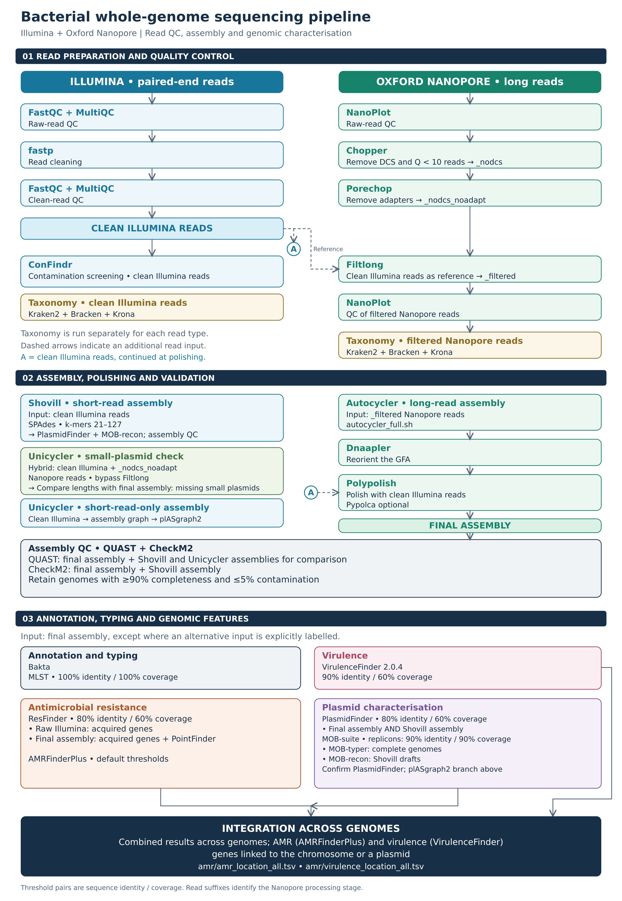

.. _objectives:

**********
Objectives
**********

In this Tutorial, you will learn how to acquire, process, and analyse raw next-generation sequencing (NGS) data from bacterial isolates (whole-genome sequencing).

.. attention::
   * This is not a mandatory, exhaustive, or official pipeline. The appropriate pipeline will depend on the **type of data** that you have and the main **objectives**.
   * The pipeline that is provided is just an **example** of one of the approaches.
   * Since **new tools and packages** are continually being developed, you may need to **update your pipeline** to include the best ones that fit your purpose.

What you'll learn
#################

The following topics will be covered:

  - Acquisition of NGS raw reads
  - Raw reads evaluation and cleaning (Illumina and Oxford Nanopore)
  - Species identification and detection of contamination
  - De novo assembly (short-read and long-read), polishing and quality control
  - Genome annotation and Multilocus Sequence Typing (MLST)
  - Detection of antimicrobial resistance genes and mutations (resistome)
  - Detection of virulence genes
  - Detection of plasmids and plasmid reconstruction
  - Running the same analysis in several genomes using Bash loops
  - Reproducible analyses using mamba environments

Learning outcomes
#################

By the end of this tutorial, you will be able to:

  - Retrieve public sequencing data from the SRA and recognise the FASTQ and FASTA formats.
  - Interpret FastQC, MultiQC and NanoPlot reports, and clean the Illumina (fastp) and Nanopore (Chopper, Porechop, Filtlong) reads.
  - Identify the species of an isolate (Kraken2/Bracken) and detect intraspecies and cross-species contamination (ConFindr).
  - Assemble short reads (Shovill) and long reads (Autocycler), reorient the replicons of the long-read assembly (Dnaapler) and polish it (Polypolish).
  - Judge the quality of an assembly using QUAST metrics, and its completeness and contamination using CheckM2.
  - Annotate a genome (Bakta) and determine its sequence type (MLST).
  - Detect acquired resistance genes and point mutations (ResFinder/PointFinder, AMRFinderPlus) and virulence genes (VirulenceFinder), and explain how the genotype is used to predict the resistance phenotype.
  - Detect, type and reconstruct plasmids (PlasmidFinder, MOB-suite, plASgraph2), and determine if a resistance gene is located in the chromosome or in a plasmid.
  - Write Bash loops to run the same analysis on several genomes and combine the results in a single table.
  - Create and use mamba environments to install the tools and reproduce the analysis.

Who is this for?
################

This tutorial is aimed at students with no previous experience in bioinformatics; the only requirement is knowing where to find your Terminal (see the :ref:`Before we begin <before-begin>` section).
You will need a computer with Linux, macOS, or Windows with WSL, ~16 GB of RAM and ~100 GB of free disk space for the full analysis (less if you use the lighter databases or the provided data).
Allow at least **1 week** of work to complete the full tutorial if you have no previous experience, including the Bash introduction, the software and database installation, and the assembly steps, which can take several hours. It may take longer depending on your pace and computer.

What you'll build
#################

  - A complete or draft microbial genome
  - A report of specific genotypic features (antimicrobial resistance genes and mutations, plasmids, and virulence genes)
  - A table that combines the results of several genomes

Pipeline
########

*Figure 1. The pipeline used in this tutorial to acquire, process, and analyze microbial genomic data. Quality control: FastQC, MultiQC and fastp (Illumina); NanoPlot, Chopper, Porechop and Filtlong (Nanopore). Taxonomy and contamination: Kraken2, Bracken, Krona and ConFindr. Assembly: Shovill (Illumina), Autocycler + Dnaapler + Polypolish (final assembly) and Unicycler (small plasmids), evaluated with QUAST and CheckM2. Annotation and typing: Bakta and MLST. Antimicrobial resistance and virulence: ResFinder/PointFinder, AMRFinderPlus and VirulenceFinder. Plasmids: PlasmidFinder, MOB-suite and plASgraph2.*
